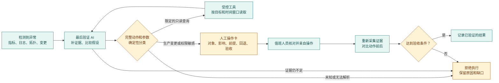
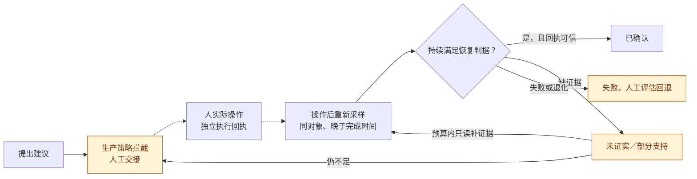
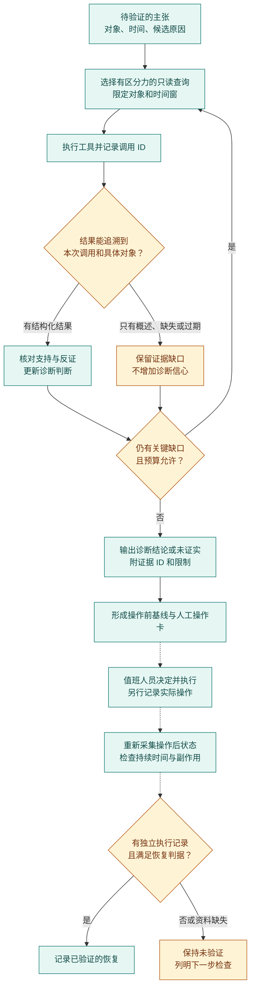

# 最后执行阶段的安全护栏与人工处置

事故调查的最后一步最容易混淆三件事：**找到了异常、提出了处置办法、已经安全地修复并验证**。本项目的 `validation_action_agent` 会复核证据、调用受控工具，并把修复建议交给执行路径。这里的 *harness* 指围绕这一阶段的一组确定性约束：检查具体动作及完整参数，限制工具能力，记录拒绝原因，并要求有新证据才能报告恢复。模型给出建议，不能靠改写提示词、把 playbook 标为 `safe`，或取得一个随响应返回的令牌来扩大自己的生产权限。

## 先按影响判断，而不是按命令名判断

同一个程序既能查看状态，也能改变状态。例如 `systemctl status` 和 `systemctl restart` 不应因为都叫 `systemctl` 就获得相同权限；后者会停止再启动服务。[systemd 官方命令手册](https://github.com/systemd/systemd/blob/main/man/systemctl.xml) `kubectl get pods` 与 `kubectl delete pod` 也不同。反过来，一个看似无害的脚本入口可以间接运行 `reboot`、修改 Git 工作树或访问凭据。因此，执行许可应落在**类型、完整参数、目标、环境、调用身份和副作用**上；无法确定时拒绝。

当前 `PlaybookRunner` 连裸的 `kubectl get` 也不执行；只读排查走已注册、有限定输入的查询工具。这样做是为了避免一条通用命令同时取得读取 Secret、切换上下文和修改集群的能力。来自日志、知识库和外部工具的文本只作为证据，不是修改工具权限的指令。

| 人工执行的操作族 | 为什么不能由最后验证 AI 自行执行 | 人工操作前要核对什么 |
| --- | --- | --- |
| 主机与服务：`reboot`、`shutdown`、关机、重启服务、`systemctl isolate`、内核参数、网络/防火墙、磁盘格式化或挂载变更 | 中断采集、丢失会话或使整机不可达；服务重启也会影响连接和内存状态 | 目标主机、业务窗口、冗余、当前告警、带外恢复方式 |
| Kubernetes：删除/驱逐 Pod、`drain`/`cordon`、扩缩容、滚动重启/回滚、修改 Deployment/ConfigMap/NetworkPolicy、集群升级 | 会改变工作负载与调度结果。直接删除 Pod/Deployment 并不受 PodDisruptionBudget 约束；Eviction API 才会检查相应预算。[Kubernetes 中断说明](https://kubernetes.io/docs/concepts/workloads/pods/disruptions/)、[Eviction API](https://kubernetes.io/docs/concepts/scheduling-eviction/api-eviction/) | namespace、对象 UID/版本、可用副本、PDB、依赖拓扑、流量与回滚条件 |
| 权限与凭据：RBAC、ServiceAccount、Secret、IAM、密钥轮换、镜像仓库或云账号授权 | 可能越权、泄露密钥，或永久改变访问范围。只读地列出 Secret 也可能暴露敏感内容。[Kubernetes RBAC 最小权限建议](https://kubernetes.io/docs/concepts/security/rbac-good-practices/) | 申请人、授权范围、过期与撤销、审计记录、敏感数据脱敏 |
| 版本与发布：`git switch`/`checkout`、`reset --hard`、`clean`、`pull`、`push --force`，以及部署、回滚和制品替换 | 切换分支会更新索引与工作树；强制切换和硬重置可以丢弃本地修改。[Git switch](https://git-scm.com/docs/git-switch)、[Git reset](https://git-scm.com/docs/git-reset) | 工作树是否干净、精确 commit/镜像摘要、配置兼容性、发布窗口、回退制品 |
| 数据与外部系统：数据库迁移/删除/恢复、存储生命周期策略、负载均衡/DNS、云资源创建或销毁、外部通知 | 可能造成数据不可逆损失、流量转移、费用或对外影响 | 备份与恢复演练、变更范围、二次核对、利益相关方 |
| 任意代码入口：裸 shell、`kubectl exec`、远程脚本、包安装、插件、容器特权启动 | 它们可绕开按动词分类的限制，把一个动作伪装成另一个动作；即使声称“只读”，也可能写文件或向外传输数据 | 不交给自动执行器；由人审查来源、参数、执行身份和隔离环境 |

上述是**对本项目执行 AI 的权限边界**，不是对值班人员的通用禁令。人工操作仍应遵守所在环境的变更流程。Kubernetes 建议为控制器身份配置最小 RBAC，而非只依赖应用内拒绝逻辑；能读到 Secret 的权限也要单独评估。[Kubernetes RBAC 文档](https://kubernetes.io/docs/reference/access-authn-authz/rbac/)

## 当前实现能保证什么

最后验证阶段已有受预算约束的工具调用，工具注册表区分只读性、安全等级、审批要求和自动选择资格。已有的结构化查询覆盖指标、日志、变更、部署历史、配置、拓扑、GPU、eBPF、内存压力、DNS/连通性、服务健康、Kubernetes 资源、容器版本、存储、网络影响范围和先前动作结果。新增的只读 `operator_preflight` 会按指定采集器汇总对象身份、遥测时间、服务健康、版本与影响范围，并明确列出缺失证据；它只准备人工判断材料，不宣称可以执行变更。**存在工具入口不等于在每个环境中都有实时数据或足够权限。** 应查看每次工具结果的来源、时间窗和错误，而不是从工具名推断问题已解决。

动作路径的默认配置为 dry-run。本次执行护栏在策略分类和 `PlaybookRunner` 的最后入口实行**默认拒绝**：所有 Kubernetes 动作、所有用于生产处置的 shell 命令都不会由该执行器运行；`echo` 和 `sleep` 仅作为进程内的测试/演示动作保留，不是主机诊断或修复能力。拦截发生在 dry-run 判断之前，因此演练也会显示“受阻并需人工操作”，不会给出“如果关闭演练就能执行”的误导结果。`PlaybookRunner` 的受阻结果附带 `operator_handoff`，列出提案、目标范围、执行前检查和事后验证；具备动作契约时还会带上前提、预计影响、波及范围与回退计划。但上层 guarded action 的常见 `proposal_only` 分支会提前返回，目前只有治理信息、动作契约与计划，**没有同一份结构化 `operator_handoff`**；值班人员须核对缺口，不能把该分支视为完整交接。`safe: true`、`AllowUnsafe` 或旧式 approval token 均不能覆盖这道边界；回滚命令也按同一规则检查。这里的旧式 token 只表示 API 请求匹配某个待处理动作，**不构成独立的人类审批证据**。

不同的演练也不能混为一谈：本地 `DryRun` 表示执行器没有发起动作；Kubernetes API 的 server-side dry-run 表示 API 请求经过相关校验但不持久化，且对 admission webhook 的副作用有要求。前者不是集群安全验证，后者也不是业务恢复验证。[Kubernetes API dry-run 说明](https://kubernetes.io/docs/reference/using-api/api-concepts/#dry-run)

## 生产环境按状态收紧权限

生产部署应同时收紧**应用内策略**和**运行身份权限**。当前执行器对 Kubernetes 变更及生产 shell 处置默认拒绝；`PlaybookRunner` 的受阻结果会生成供值班人员审查的交接材料，上层 guarded `proposal_only` 目前只有计划与治理材料。部署方仍须把控制器的集群身份限制在必要的只读资源、目标 namespace 和审计范围内。不能把模型的建议、工具回显、`safe` 标志、旧式 token 或一次 dry-run 当作独立的人类授权。只读工具也要限制对象、时间窗、返回量和敏感字段。若底层凭据有写权限，应用代码的一道拦截不足以构成生产隔离。

闭环必须区分**提出、执行、观察、确认**四件事。下表是生产验收口径；其中人工执行回执到系统的自动接入仍未实现，不能因为画出了状态箭头就宣称生产处置已经闭环。

| 状态 | 进入该状态需要什么 | 对外可以说什么 |
| --- | --- | --- |
| **已提出** | 候选原因、目标范围、建议动作和证据缺口 | 有建议；没有发生变更 |
| **已交接／待人工** | 确定性策略拒绝自动变更，且预检、目标、影响与回退条件形成可审查的完整交接；仅有 `proposal_only` 计划不能越级 | 值班人员可审查；尚无执行结果 |
| **已执行** | 来自执行方的独立记录：动作 ID、操作者、目标对象及版本、实际参数、开始和完成时间、成功或失败；必须能对应原提案 | 只能说明动作实际发生；不能宣称服务恢复。当前人工执行记录未接入，不能由 AI 自填这一状态 |
| **操作后已观测** | 在动作完成后重新采集同一服务范围的样本，保留采样时间、来源、健康指标和异常／副作用 | 有效果线索；单次好转或重复读取同一份指标仍待观察 |
| **已确认** | 预设观察窗内服务恢复健康、实测指标改善、范围与时间可比、未见阻断性退化；项目内实际执行路径还要求两次采样时间递增的健康结果，生产人工处置另需可信执行记录 | 在列明对象、窗口和判据后，才报告该次处置已验证 |
| **部分支持／未证实／失败** | 分别对应部分指标改善、关键样本或执行记录缺失、动作失败或出现反证 | 保留原状态和缺口；退回只读取证或人工处置，不自动写成成功 |

虚线表示**尚未接通的人工执行记录与生产效果链路**。现有代码只对项目内实际执行的 live 动作开展有时限、最多 24 轮的只读操作后观察；建议、dry-run、计划和受阻动作不能进入这个效果确认路径。即使工具结果写着“已执行”，若本轮调用因幂等缓存或历史记录复用而被跳过，也不能算新的执行回执，更不能据此启动本轮效果确认。一次工具返回“成功”也不能直接写成已验证：前后服务快照须可比，且观察窗口内要有**两次同一范围、采样时间递增的健康结果**。每轮操作后查询会重新调用只读工具，风险复核也重新取样；节点指标采样和已构建的指标／日志风险序列必须在动作完成后更新且未过期，避免把缓存或旧结果当成新证据。安全事件、eBPF 事件和变更关联的源时间仍需逐项校验，不能从上述门槛推断所有风险来源均已新鲜。报告保留 `observation_count`（观察次数）、`stable_healthy_samples`（连续有效健康样本数）和 `healthy_sample_times`（被计入的采样时间）；`observation_evidence_ids` 保留所有尝试供审计，只有连续合格样本的 ID 才进入确认结论的支持证据。旧样本重复读取、窗口耗尽、预算用尽或取消均不能得到“已确认”。这套内部判定不自动适用于交给人完成的生产变更。闭环的重试只应调用有范围限制的只读工具；达到观察窗口或查询预算仍无证据就停止并显示“未证实”。

## 把判断接到可核对的证据上

更强的 agent 不等于让模型自由尝试更多命令。对事故调查有用的循环是：先写明要区分的假设，再选择能回答这个问题的只读工具；收到结果后核对对象、时间窗和调用记录，更新支持、反证与缺口，最后决定继续查询还是停止。工具调用和环境返回是反馈，文字总结只是对反馈的解释。[Anthropic 的 agent 设计说明](https://www.anthropic.com/engineering/building-effective-agents)强调从环境结果获得反馈，并为循环设置停止条件；[工具设计说明](https://www.anthropic.com/engineering/writing-tools-for-agents)也建议用贴近真实任务的评测检查工具输入、输出及调用轨迹。

图中虚线是尚未由本项目打通的人工执行与操作后验证闭环，不表示当前 agent 能代人操作或已经接入真实结果。

这轮的证据门槛把最后验证 AI 的正向判断与**实际工具调用 ID**关联。工具给出有类型、能对应目标的结果时，才有资格增加相应主张的信心；只有一段未注明对象、来源和调用的概述时，应记录为待核实线索，不能靠流畅的文字提高信心。反证、超时与缺失数据也要保留。这里核对的是“这次调查是否得到相应证据”，不是通过 ID 自动证明证据所述的因果关系。

对 `service_health`，本轮还要求明确区分“确实采到健康状态”和“没有拿到遥测”，并核对结果是否属于当前服务范围。新鲜度依据**每项服务指标自身的采样时间**，不能用最近一次心跳或新批次冒充新样本；同一采集器内如果混入不同服务、namespace、工作负载或 Pod 的指标，或同一批次出现重复的健康指标名，结果会标为范围歧义而不可用于健康结论。完全没有服务标签时只能识别到采集器，不能据此证明某个具体服务已恢复。缺遥测不能被当成健康，别的范围内的健康状态也不能为当前对象背书。场景判断同样需要与该场景相符的结构化信号，例如网络异常要有网络工具测得的异常线索；只有通用摘要或“服务不健康”，不能确认某个特定场景或根因。其他工具仍需逐项完善对象与新鲜度检查，因此不能把这一条当成所有工具都已完成同样校验。

| 想要说明什么 | 可以怎样检验 | 容易误判的材料 |
| --- | --- | --- |
| **症状仍在** | 同一对象、同一时间窗的服务健康、指标或日志 | “服务不健康”只能说明现状，不能单独确认某次发布、某张 GPU 或某个配置就是根因 |
| **某个候选原因有依据** | 对齐对象与时间的变更、配置、资源和传播链，并逐项保留反证 | 相似事故、单次异常和概述性摘要不能替代当前事件的匹配证据 |
| **可以交给人处置** | 只读预检给出身份、版本、健康基线、影响范围和仍缺的检查 | `operator_preflight` 完成不表示变更已获批准、已执行或一定安全 |
| **系统已经恢复** | 同一服务范围的动作前后快照；动作后样本必须在动作完成后重新采集，健康判断所需指标齐全且新鲜，服务已恢复健康并有至少一项实测结果（健康状态、延迟或错误率）改善，再核对风险变化和副作用；人工处置还需实际执行记录 | 风险评分降低或错误日志减少只是辅助信号；操作前基线、dry-run、建议已交接、动作中样本、重复读取旧样本或仍不健康的服务都不是恢复结果 |

尤其要分清**操作前**和**操作后**：当前 `operator_preflight` 只生成操作前材料。项目内的动作后比较只有在前后新鲜服务结果可用、实测服务指标改善、两次不同时间的健康后验样本及其他判据满足时，才可给出“已确认”的效果判断；仅有风险评分或日志下降最多是部分支持。人工执行记录的接入尚未打通，所以对交给值班人员执行的生产变更，没有独立记录与动作后取证时仍应报告“已提出／结果未验证”；具备完整人工交接材料时才能称“已交接”。将来接入真实集群与人工执行记录后，还需用可复现的故障注入和工作负载检验完整闭环。[AIOpsLab](https://microsoft.github.io/AIOpsLab/)提供故障、负载、遥测与交互式任务评估的参考结构；它不是本项目已经完成生产恢复评测的证据。[Agent 评测指南](https://www.anthropic.com/engineering/demystifying-evals-for-ai-agents)区分调用过程与环境最终状态，提醒我们不能仅凭一份看似完整的调查报告判断任务成功。

## 让 AI 更会处理问题，但不替人做危险操作

改进方向是把**诊断能力、操作准备和效果验证**做强，而不是开放通用 shell。一次有效的建议应能回答“为什么是这个对象、什么证据反对这个结论、操作前还缺什么、操作后怎样证明有效”。

| 阶段 | 已有工具入口与可用产物 | 需要继续补强的能力 |
| --- | --- | --- |
| 定位 | 指标、日志、GPU、内存、eBPF、Kubernetes 资源与拓扑查询 | 统一对象 ID/版本与时间窗；对缺数据和过期数据明确降级 |
| 解释 | 变更、部署历史、配置、历史事故、相似案例、runbook | 将候选根因与支持/反证逐项对应；区分同时发生和因果传播 |
| 操作准备 | 修复建议、工具契约、策略与执行结果；`PlaybookRunner` 的受阻动作有 `operator_handoff`，guarded `proposal_only` 尚缺同等结构化交接 | 补齐该早退分支的交接材料、业务影响、备份/回退和停止条件，并与人工执行记录关联 |
| 变更前预检 | `operator_preflight` 将对象身份、数据新鲜度、健康基线、版本、影响范围及缺口放到同一份只读结果；最后验证 AI 继续调用 GPU/内存/存储和先前动作结果等工具 | 接入有明确身份和范围的实时集群只读接口，检查可用副本、依赖和 PDB；API dry-run 仅作辅助，不代替人工决定 |
| 验证 | 复查指标、日志、服务健康与动作前后记录 | 定义时间窗、基线、对照、成功阈值与副作用监测；结果不充分时明确写“未验证” |

这些补强应通过**有输入 schema、限定对象与返回大小的专用工具**实现。工具读取生产数据时仍要检查 RBAC、脱敏、超时、分页、速率和审计；“只读”不等于可以无限制读取。通用命令、脚本解释器和任意 `kubectl` 参数不应成为能力缺口的快捷补丁。

## 人工操作卡与验收方式

当建议涉及人工类动作时，完整交接记录至少应包含：事故与证据 ID、目标集群/namespace/主机及对象版本、当前状态、建议动作及其理由、可能影响、执行前检查、停止条件、备份和回退计划、执行后的观测窗口、成功与失败判据。命令只能作为**供人审查的草案**，不能复制成后台自动任务。值班人员按自己的授权和变更流程执行后，应单独记录实际操作者、时间、实际变更与结果，随后由系统重新采集证据。没有外部执行记录时，系统只能报告“建议已提出”，有完整交接材料才可报告“已交接”；两者都不能报告“已修复”。

验证 harness 应包含三层：

1. **安全反例**：对重启/关机、服务重启、Git 切换/重置、Kubernetes 删除/扩缩容/滚动重启、RBAC/Secret、任意 shell、未知动作及回滚逐项测试；改变 `safe`、`AllowUnsafe`、token 或 dry-run 都不得让人工类动作落到执行器。
2. **能力正例**：只读工具能在指定对象和时间窗内返回有来源的证据；超时、缺权限、数据过期及空结果不会变成虚假的“正常”。
3. **效果验证**：用可回放事故检查诊断与操作卡的质量，再在影子环境和受控灰度中比较动作前后指标、用户可见症状和副作用。合成测试通过只说明对应边界得到验证，不等于真实生产恢复已经证明。[评估方法](evaluation.zh-CN.md)

这份边界故意保守。若未来要让 AI 自动执行某一种低风险变更，应先为**单一、明确的动作类型**建立对象约束、最小权限、预算、并发限制、可重放审计和独立效果测试，再单独讨论授权；不能通过扩大命令白名单或把审批布尔值改成 `true` 来完成。
