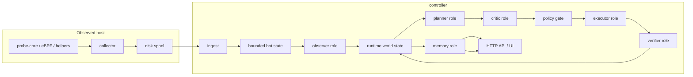

# Project handbook

[Project homepage](../README.md) · [简体中文](operator-guide.zh-CN.md)

[Start locally](#start-the-local-stack) · [Operations](#operations) · [Inference monitoring](#llm-serving-and-gpu-monitoring) · [DevSecOps audit](#devsecops-audit-workspace) · [Runtime architecture](#runtime-architecture)

## Start the local stack

### Install the build prerequisites

The [quick start](../README.md#quick-start) lists the Go and Node.js versions. Python 3.11 supports the optional Python runtime. A C++20 compiler, protobuf, zlib and pkg-config enable the native probe. The build reports any native probe fallback.

Run the [homepage commands](../README.md#quick-start) to launch the collector, controller and web UI.

Open <http://127.0.0.1:8080/> or use the address printed at startup. Press `Ctrl+C` to stop the stack. Run `make help` for other entry points.

### Configure the local stack

The local runner loads [controller.yaml](../configs/controller.yaml) and [collector.yaml](../configs/collector.yaml). Set `SRE_CONTROLLER_CONFIG` and `SRE_COLLECTOR_CONFIG` to select different files. Restart the local stack to apply these settings. The [deployment guide](../deploy/README.md) covers containers and Kubernetes.

### Check the first samples

Inspect `GET /api/v1/status` and `GET /api/v1/ingest/status`. Then confirm the node, timestamp and trend window in the dashboard. The startup log also reports the probe status.

### Run the demo

Stop the local stack and run `./scripts/run-local.sh --demo --llm=stub`. This starts the controller with synthetic telemetry and a local model stub. The sample incidents show how to navigate an investigation.

## Operations

### Investigate an incident

Consider a process whose resident memory grows over several samples. Start with the process, host and observation window. Query reclaim pressure, swap, OOM events and retry activity for the same interval. Use this evidence to order hypotheses such as a leak, cache growth or sustained retries. [Memory-pressure example](../eval_data/knowledge/cases/memory-pressure-runbook.md)

The investigator records the strongest hypothesis, the supporting evidence and any remaining questions. If new queries stop yielding evidence, hand off the open questions with the run ID. An operator uses the planned scope and approval conditions to decide whether to collect profiles or make a production change. [Action harness](action-harness.zh-CN.md)

#### Hand off an investigation

Record the observed behavior, current assessment, missing evidence and next check. Include the action status and attach the run ID, observation window and evidence references.

### Query operations and evidence

| Task | HTTP endpoint |
| --- | --- |
| Check controller and ingest status | `GET /api/v1/status` and `GET /api/v1/ingest/status` |
| Check model serving and same-node GPU evidence | `GET /api/v1/inference/overview` with optional `collector_id` |
| Read the current RCA result | `GET /api/v1/agent/rca?refresh=false` |
| List investigations or inspect a run | `GET /api/v1/agent/workflow/runs` and `GET /api/v1/agent/workflow/runs/{run_id}` |
| Trace a finding to its evidence and steps | `GET /api/v1/agent/workflow/evidence/{run_id}` and `GET /api/v1/agent/workflow/artifacts/{run_id}` |
| Review workflow tool calls and policy decisions | `GET /api/v1/agent/workflow/audit` |
| Check tool contracts and usage policy | `GET /api/v1/controller/tools` |

The default local layout stores run metadata in `data/agent/workflow_runs.db`, step messages in `data/agent/workflows/messages/<run_id>/` and evidence in `data/agent/workflows/evidence/<run_id>/package.json`. Deployment settings select the actual storage backend and paths.

Enable the audit workspace, then open **Security Dashboard → DevSecOps Audit** for scan findings, correlations and anomalies. [DevSecOps audit setup](#enable-the-workspace)

### Run the Kubernetes GPU demo

The [GPU platform demo](../examples/gpu-platform-sre/README.md) uses external vLLM workloads, with optional KServe. The collector and controller record GPU telemetry and incident evidence during the rollout and rollback exercise.

```bash
make gpu-platform-validate
make gpu-platform-smoke
make gpu-platform-evidence-template
```

The demo guide describes cluster prerequisites, explicitly enabled steps and rollback commands.

## LLM serving and GPU monitoring

The collector can read a vLLM Prometheus endpoint and push model/engine observations
alongside existing GPU telemetry.

### Connect a vLLM endpoint

Set a reachable metrics URL in [collector.yaml](../configs/collector.yaml).

```yaml
inference_metrics:
  interval: "30s"
  timeout: "2s"
  endpoints:
    - name: "local-serving"
      url: "http://127.0.0.1:8000/metrics"
```

Restart the collector with that configuration, then open **GPU Observability →
LLM serving & GPU evidence** or read `GET /api/v1/inference/overview` (optional
`collector_id` filter). The selector works without GPU inventory. Empty endpoints
disable scraping; this feature does not call model inference or require provider keys.

### Interpret the readings

| Operator question | Evidence shown | Interpretation boundary |
| --- | --- | --- |
| Why is the first token slow? | Waiting requests, interval mean first-token delay, KV-cache occupancy | Advisory thresholds are configurable, not an SLO verdict |
| Why is streaming slow? | Interval mean inter-token latency and token throughput | Means are not p95; request-level time per output token is a separate statistic |
| Is GPU pressure involved? | Same-node allocated memory, compute activity, explicit throttle flags and new Xid/ECC deltas | Node proximity does not prove model-to-device ownership or hardware failure |

### Freshness and capacity

Two observations establish rates and histogram means. Warmup, resets and idle
histogram intervals can leave derived values unavailable; actual zero remains zero.
Each value has its own timestamp. Failed scrapes suppress current model advisories;
expired values disappear after `inference.stale_after` (default two minutes).
Targets are retained for thirty minutes. Thresholds and bounded storage settings
are in [controller.yaml](../configs/controller.yaml) and require a controller restart.
Retained applied ingest receipts restore this projection after restart without
repeating ordinary observer side effects. Scrapes are limited to eight
targets, one MiB per response and 32 model/engine pairs per target; redirects and
URL credentials are rejected. Unsupported or malformed targets report unavailable.

Metric aliases follow the
[vLLM metrics reference](https://docs.vllm.ai/en/latest/usage/metrics/).

## DevSecOps audit workspace

Open **Security Dashboard → DevSecOps Audit** to import CI scan reports and Kubernetes audit logs, then review correlations, denial-rate anomalies, and their evidence.

### Enable the workspace

1. In a single-controller deployment, set `auth.enabled: true` and keep `ha.enabled: false`. [Controller configuration](../configs/controller.yaml)
2. Set `SRE_SECURITY_AUDIT_PATH` to a dedicated file on a writable persistent volume, such as `/var/lib/ai-sre/security-audit.json`, then restart the controller. The controller writes the snapshot with owner-only file permissions.
3. Use credentials with Viewer access to query evidence. Import and **Explain audit** require Operator access. In `api_key` or `mixed` mode, either operation also accepts the existing action key. Authorization applies at the controller level. Asset IDs scope filters and correlations.

### Import evidence

Use the same **Asset ID** for CI and Kubernetes reports about the same deployed asset, such as `prod/checkout`. An asset ID is at most 128 characters, starts with a letter or digit, and permits ASCII letters, digits, and `._:/-`. When a cluster hosts multiple applications, scope each export to a workload and map it to the matching deployed asset.

| Format | Import behavior |
| --- | --- |
| **SARIF 2.1.0** · `sarif` | Retains the scanner, rule, severity, and relative path when safe to display. Enter **Scan time** or send `observed_at` in RFC 3339. If omitted, the workspace uses reception time. Reuse the original scan completion time when CI retries. A later scan that reports the same finding refreshes its observation time. |
| **Kubernetes Audit v1** · `kubernetes` | Export at the `Metadata` level as JSONL, a single `Event`, or an `EventList`. The workspace reads the `ResponseComplete` and `Panic` stages and uses the event timestamp. Each asset, audit ID, and stage combination counts once. |

The workspace stores normalized evidence. Import discards request and response bodies, raw request URLs, scanner messages, and original fingerprint values.

In the browser, choose **Report format** and **Report file**, then select **Import report**. CI and log-forwarding jobs can call the same endpoint. This example imports SARIF using the compatibility action key.

```bash
set -o pipefail
jq -n --arg asset 'prod/checkout' --arg format 'sarif' \
  --arg observed_at "${SCAN_COMPLETED_AT:?set the original scan completion time in RFC3339}" \
  --rawfile report results.sarif \
  '{asset: $asset, format: $format, observed_at: $observed_at, report: $report}' |
  curl --fail-with-body --silent --show-error \
    -H "X-API-Key: ${CONTROLLER_ACTION_KEY:?set the controller action key}" \
    -H 'Content-Type: application/json' --data-binary @- \
    "${CONTROLLER_URL:?set the controller URL}/api/v1/security/audit/import"
```

For token authentication, replace the API key header with `Authorization: Bearer <operator-token>`. For Kubernetes logs, change the format to `kubernetes`, substitute the log file, and remove `observed_at` from both the command and the JSON object. The import response returns counts in `imported` and `updated`.

### Review analysis and follow the evidence

Choose an **Audit window** and select **Load audit**. Leave **Asset ID** blank to see all assets. Select the evidence ID on a correlation or anomaly to jump to the corresponding record.

| Result | How to interpret it |
| --- | --- |
| Event sequence | At least five 401 or 403 responses on the same asset and actor precede a successful RBAC change or Secret read within 15 minutes. Check the actor’s approved access. |
| Cross-source correlation | A high-severity SARIF finding and a successful sensitive Kubernetes request on the same asset occur within one hour. Check the deployment inventory and change history to determine whether they concern the same workload. |
| Denial-rate anomaly | Each complete UTC hour uses at least 10 terminal events for the asset. The baseline uses median and MAD across at least eight qualifying hours from the preceding 48 hours. The calculation skips collection gaps. Import both successful and denied requests to preserve the denominator. |

After loading a specific asset, select **Explain audit** for a rules-based investigation summary. To let a model rank multiple candidates, set `SRE_SECURITY_AUDIT_LLM_ENABLED=true` with the existing `SRE_AGENT_LLM_*` configuration and restart the controller. The model receives candidate indices, signal categories, and numeric features. The controller renders the investigation text and supplies the evidence links. It uses a rules-based summary when the model times out, is busy, or returns an invalid selection.

### API and capacity

| Request | Parameters |
| --- | --- |
| `POST /api/v1/security/audit/import` | JSON fields `asset`, `format`, `report` (the file contents as a string), and optional `observed_at`. |
| `GET /api/v1/security/audit?asset=prod%2Fcheckout&window=168h` | Both query parameters, `asset` and `window`, are optional. |
| `POST /api/v1/security/audit/explain` | Both JSON fields, `asset` and `window`, are optional. |

- The query window defaults to `168h` and supports up to `720h`. The evidence list returns the latest 500 records plus any additional records cited by correlations or anomalies.
- Each import accepts up to 4 MiB of report content and 10,000 input records. A malformed record, a timestamp before the retention window, or a timestamp later than the controller’s current time rejects the entire batch.
- The workspace retains the latest 30 days, with limits of 20,000 normalized records and 64 MiB per snapshot. Reads exclude expired evidence. Writes prune expired evidence and replace the snapshot atomically. Batches that exceed capacity are rejected.

### Design and research

#### Reference patterns · 参考方案

| Pattern and upstream source | Project design · 项目实现 |
| --- | --- |
| **Scan import and identity** [OASIS SARIF 2.1.0](https://docs.oasis-open.org/sarif/sarif/v2.1.0/sarif-v2.1.0.pdf) · [GitHub Code Scanning](https://docs.github.com/en/code-security/reference/code-scanning/sarif-files/sarif-support) · [DefectDojo Reimport](https://docs.defectdojo.com/import_data/import_intro/reimport/) | Scope a finding by asset, scanner, rule, location, and available fingerprints. Match reimports without closing findings omitted from partial reports. 按资产、扫描器、规则、位置和可用指纹识别发现。部分扫描未报出的发现保留至留存窗口结束。 |
| **Runtime input and normalization** [Kubernetes Auditing](https://kubernetes.io/docs/tasks/debug/debug-cluster/audit/) · [OCSF](https://schema.ocsf.io/) | Ingest terminal audit stages through a metadata allowlist. Use OCSF as a reference for field selection. 使用元数据白名单导入终态审计事件，参考 OCSF 选取字段。 |
| **Event correlation** [Sigma Correlation](https://sigmahq.io/sigma-specification/specification/sigma-correlation-rules-specification.html) · [Wazuh Rules Syntax](https://documentation.wazuh.com/current/user-manual/ruleset/ruleset-xml-syntax/rules.html) | Use asset and actor scopes, explicit time windows, and evidence references for rule matches. 用资产和主体约束作用域，按明确时间窗口匹配事件，并返回证据引用。 |
| **Statistical explanation** [Elastic Anomaly Score Explanation](https://www.elastic.co/docs/explore-analyze/machine-learning/anomaly-detection/ml-ad-explain) | Return the observed rate, typical rate, score, and sample count from a rolling median and MAD baseline. 用滚动中位数和 MAD 建立基线，返回观察值、基线值、分数与样本数量。 |
| **Model input and output boundaries** [OWASP Prompt Injection](https://genai.owasp.org/llmrisk/llm01-prompt-injection/) | Offer a bounded set of local candidate indices, signal categories, and numeric features. Validate one selected index and render the result in the controller. 仅提供有限的本地候选序号、信号类别和数值特征，校验模型选中的序号，由控制器生成结果。 |

#### Implementation · 实现

- The controller parses and validates a complete import before attempting an atomic snapshot update. The record schema is defined by this project. 控制器先解析和校验整个批次，再尝试原子更新快照。记录采用本项目的字段契约。 [Import code](../backend/internal/controller/securityaudit/import.go) · [Workspace code](../backend/internal/controller/securityaudit/workspace.go)
- For qualifying UTC hours, the anomaly score is `(denial_rate − baseline) / max(1.4826 × MAD, 0.05)`. An evaluated hour needs at least three denials and a score of at least `3.5` to produce an anomaly. The response returns up to 100 correlations and 50 anomalies. 对符合条件的 UTC 小时使用上述分数。待判定小时至少有三次拒绝且分数达到 `3.5` 才会产生异常。响应最多返回 100 条关联和 50 条异常。 [Analysis code](../backend/internal/controller/securityaudit/correlation.go)
- Rules run before model ranking. The query response carries evidence IDs, and the controller maps the selected candidate back to those IDs. 规则分析先于模型排序。查询响应包含证据 ID，控制器将选中的候选项映射回这些 ID。 [Explanation code](../backend/internal/controller/securityaudit/explain.go)

## Runtime architecture

### Runtime shape



The controller still runs these logical agents in one process. The important boundary is the persisted state and artifact contract, not the process boundary. The adaptive loop is bounded by `AdaptiveMaxIterations`, `AdaptiveMaxToolCalls`, same-tool retry limits, hypothesis rewrite limits, and a time budget. Each meaningful step emits compact records with:

- schema version
- producer and consumer
- workflow / incident / correlation IDs
- timestamps and status
- input artifact IDs
- evidence references
- replay flags

The chain lives inside the RCA evidence package and is exposed through the workflow APIs.

### Unix composition

Each module owns one job and hands off through an explicit interface.

| Module | Job | Handoff |
| --- | --- | --- |
| Probe and collector | Sample the host and buffer batches locally | Telemetry batches and durable ingest receipts |
| Controller | Apply policy and coordinate investigation | Versioned workflow records and evidence IDs |
| Operator tools | Present evidence for operator review | HTTP JSON, files and process exit codes |
| Release tooling | Check public inputs and package reviewed source | Standard output for results, standard error for diagnostics |

Security audit follows the same pattern. A scanner or Kubernetes audit exporter produces a file. The controller imports and normalizes it. Rules and statistical baselines read the normalized records. The UI links findings back to their evidence. The optional model ranks investigation candidates. Each step has an input and an output that an operator can inspect. [DevSecOps audit guide](#devsecops-audit-workspace)

[Repository checks](../CONTRIBUTING.md#repository-and-release-checks) use the same shell entry points on a workstation and in CI.

### Telemetry sources and privileges

The current collector is kernel-first where the repo can do that without inventing a new runtime:

- host CPU scheduler counters: `perf_event_open` software counters in `cpp/probe_core/main.cpp`
- per-process accounting: `cpp/probe_core/process_kernel_collector.cpp` using `taskstats` generic-netlink
- interface/link counters: `cpp/probe_core/network_kernel_collector.cpp` using `rtnetlink`
- socket queue state: `cpp/probe_core/network_kernel_collector.cpp` using `sock_diag`
- runtime event flow: the probe-core eBPF socket path now accepts a versioned binary record format in `cpp/probe_core/kernel_event_protocol.cpp`, with JSON fallback for compatibility
- GPU: `cpp/probe_core/gpu_nvml.cpp` through NVML only; the probe-core hot path no longer shells out to `nvidia-smi`

The remaining file-based paths are explicit fallback or cold-path mechanisms:

- PSI: `/proc/pressure/*`
- cgroup stats: `/sys/fs/cgroup/...`
- disk counters and queue attributes: `/sys/block/*` with `/proc/diskstats` fallback
- process reconciliation and top-row enrichment: periodic `/proc` scans plus `/proc/<pid>/smaps_rollup` and `/proc/<pid>/fd`
- hardware discovery: infrequent `/proc` and `/sys` reads under `hardware.refresh_interval`

Privilege reality in this tree:

- `CAP_BPF` or `CAP_SYS_ADMIN` still gates the primary eBPF path
- `CAP_PERFMON` or `CAP_SYS_ADMIN` is the clean path for perf-based host counters
- `CAP_NET_ADMIN` or `CAP_SYS_ADMIN` is the expected privilege boundary for the taskstats/sock_diag process path
- when those capabilities are missing, the collector stays up and falls back instead of pretending the kernel path exists

### Runtime modes

`WorkflowConfig.RuntimeMode` controls the migration path:

| Mode | Behavior |
| --- | --- |
| `legacy_deterministic` | Preserves the legacy fixed pipeline and is the default safe posture. |
| `hybrid_adaptive` | Runs the scene-aware deterministic pipeline, then inserts the governed adaptive loop before the analysis-to-validation handoff. |
| `full_adaptive` | Uses the same bounded controller-governed adaptive loop with the full planner/critic/verifier surface, richer scoring, and experience-memory biasing. |

Legacy aliases are still accepted for backward compatibility:

- `deterministic` -> `legacy_deterministic`
- `hybrid` -> `hybrid_adaptive`
- `adaptive` -> `full_adaptive`

The migration flags now live on `WorkflowConfig` as well as `runtime_mode`:

- `adaptive_runtime_enabled`
- `autonomous_tool_selection_enabled`
- `planner_critic_enabled`
- `tool_experience_memory_enabled`
- `cheap_first_selection_enabled`
- `max_no_progress_rounds`
- `max_uncertainty_plateau_rounds`
- `adaptive_parallel_read_only_limit`

Set `SRE_AGENT_WORKFLOW_RUNTIME_MODE=hybrid_adaptive` or `SRE_AGENT_WORKFLOW_RUNTIME_MODE=full_adaptive` to enable the new path. If the mode is unset or invalid, the controller normalizes back to `legacy_deterministic`.

### Tool contracts and execution policy

Model output can propose evidence gaps, hypotheses, tool candidates, contradiction checks, query refinements, and stop-or-continue recommendations. The controller grants execution eligibility according to policy. Knowledge retrieval is a read-only skill that adds references to the evidence bundle.

Autonomous tool selection in the adaptive loop excludes state-changing tools.
Remediation proposals use a separate governed execution path; changing runtime
mode does not grant permission to modify production state.

The [action harness and human handoff guide](action-harness.zh-CN.md)
describes the final validation/action agent's boundary. Host reboot, service
restart, Git version switching, Kubernetes mutations, credential changes, and
other production-impacting operations belong to an operator, with the AI
preparing evidence and an auditable action proposal. A returned action token is
not evidence of independent human approval.
The read-only `operator_preflight` tool packages target identity, telemetry
freshness, service health, revision, and impact scope, while naming missing
checks that an operator must complete before a change.

Controller code gates the remaining execution surface:

- tool contract validation
- actuator safety classification
- a final runner harness that blocks Kubernetes actions and operational shell commands, including rollback
- policy status and legacy token checks where applicable
- idempotency keys, timeouts, and tool-call budgets for permitted fixtures
- evidence-based post-action verification after an operator performs a production change

Contracts also carry preferred query hints plus freshness and scope sensitivity. The adaptive loop uses those fields to shape query windows and scopes before each autonomous tool call.

The skill registry surface exposed at `/api/v1/controller/tools` includes the stable name, version, capability family, schemas, read-only posture, safety class, approval requirement, autonomy eligibility, cost/freshness/scope sensitivity, expected information gain, policy status, and recent low-yield/result-quality signals. These fields are the operator-facing contract for skills-first control and must stay backward-compatible.

Default posture remains conservative:

- dry-run on
- legacy action-token checks where configured; a token is not human approval
- production-impacting actions blocked for operator handoff
- validation defaults to read-only

#### Logical roles and ownership

| Role | Owns | Reads | Writes | May change live state? |
| --- | --- | --- | --- | --- |
| observer | current window summary and runtime state | collector snapshots, bounded history | observation + objective artifacts | no |
| planner | next objective, candidate tool/action proposals | runtime state, evidence gaps, hypotheses | planner proposal + tool decision artifacts | no |
| critic | hidden-assumption, safety, and no-progress checks | planner proposal, tool contract, policy posture | critique report + branch decision artifacts | no |
| policy gate | execution eligibility | proposal artifact, controller policy, tool contract | execution-plan / execution-intent artifact | no |
| executor | governed tool calls | policy-approved tool decision | tool-result summary / execution result | production mutations are handed to an operator |
| verifier | uncertainty, confidence, contradiction, gap, and action-effect deltas | tool result, before/after runtime state | progress assessment + verification delta | no |
| memory | final incident record | full chain | final incident artifact, incident memory | no |

The old `analysis_agent` and `validation_action_agent` code paths still exist. The adaptive loop adds explicit `planner`, `critic`, `executor`, and `verifier` turns inside the same controller process and writes them to `DurableRun.AdaptiveDialogue`.

### Workflow records and evidence

The incident workflow still emits the compact incident chain:

1. `observation_summary`
2. `anomaly_finding`
3. `root_cause_hypothesis`
4. `remediation_proposal`
5. `execution_plan`
6. `execution_result`
7. `verification_result`
8. `incident_report`

Hybrid and adaptive runs also append adaptive artifacts such as `runtime_state`, `objective_state`, `planner_proposal`, `tool_candidate_scores`, `critique_report`, `tool_decision`, `tool_result_summary`, `progress_assessment`, `branch_decision`, `execution_intent`, `stop_decision`, `verification_delta`, and `experience_memory_update`. Each artifact is compact by design. Raw telemetry stays out of the handoff. The artifact carries evidence IDs, decisions, scores, deltas, normalized tool results, and short references so downstream stages can reload details without copying large payloads through every step.

New adaptive artifact fields are versioned and decoded with defaults so older evidence packages remain readable. Replay never re-executes side effects. Production mutations remain proposal-only at the final runner boundary, including when a legacy approval token is present.

The concrete schema is defined in `backend/internal/controller/agentcore/workflow_artifacts.go` and related tests.

### Reliability and deployment

Things that can and do go wrong:

- stale or partial telemetry
- controller restart during an incident
- action proposal without enough rollback data
- verification that cannot prove improvement because the evidence window is weak
- duplicate requests for the same incident shape

The current design handles those cases by preserving state, surfacing uncertainty, and preferring proposal-only over unsafe execution.

Telemetry ACKs now follow a durable bbolt/PostgreSQL receipt and applied
checkpoint. Spool v2 adds CRC32C records and crash-safe cursor/migration handling.
See [telemetry durability](../deploy/telemetry-durability.md) for retention limits,
observer replay boundaries, storage requirements and restart tests.

#### Resource model

The code is written around bounded cost, not idealized throughput.

- **Memory**: controller hot state and evidence references are bounded; artifact payloads are compact summaries, not telemetry dumps.
- **FD usage**: the collector spools to disk, the controller persists artifacts through the artifact manager, and the workflow avoids keeping per-incident files open longer than a single write or read path.
- **Concurrency**: action execution is explicitly bounded. Validation loops run under tool-call and iteration budgets.
- **Queue growth**: replay and spool paths are bounded and visible. The workflow artifact chain does not create an unbounded side queue.
- **Serialization cost**: the artifact chain is small enough to ship inside the evidence package and cheap enough to decode during debugging.

#### Deployment boundary

The controller keeps recent state in one active writer. HA followers reject ingest writes. Deployment settings can place run and artifact metadata in PostgreSQL and artifact payloads in object storage. [Deployment options](../deploy/README.md)

### Source code entry points

| Area | Entry point | Responsibility |
| --- | --- | --- |
| Host probe | [`cpp/probe_core/main.cpp`](../cpp/probe_core/main.cpp) | CLI parsing, host CPU and memory collection, `/proc` parsing, and compression |
| GPU sampling | [`cpp/probe_core/gpu_nvml.cpp`](../cpp/probe_core/gpu_nvml.cpp) | NVML device and process samples |
| Collector | [`backend/internal/collector/collector.go`](../backend/internal/collector/collector.go) | Collector construction, identity, and external metric command parsing |
| Spool and transport | [`spool.go`](../backend/internal/collector/spool/spool.go) and [`client.go`](../backend/internal/collector/transport/client.go) | Durable offsets, batching, acknowledgements, and TLS |
| Controller runtime | [`controller.go`](../backend/internal/controller/controller.go), [`agent.go`](../backend/internal/controller/agentcore/agent.go), and [`workflow_engine.go`](../backend/internal/controller/agentcore/workflow_engine.go) | API assembly, query service, and workflow orchestration |
| Skills and adaptive loop | [`backend/internal/controller/agentcore/`](../backend/internal/controller/agentcore/) | Tool contracts, scoring, query shaping, normalization, planning, critique, verification, and replay state |
| Durable artifacts | [`workflow_artifacts.go`](../backend/internal/controller/agentcore/workflow_artifacts.go) and [`workflow_orchestrator.go`](../backend/internal/controller/agentcore/workflow_orchestrator.go) | Artifact chains plus BoltDB/Postgres durable stores |
| Web UI | [`frontend/src/`](../frontend/src/) | React 18 + Vite operator interface |

#### Tool execution sequence

Use this file order when auditing or changing the runtime:

1. `backend/internal/controller/agentcore/workflow_engine.go`
2. `backend/internal/controller/agentcore/workflow_tools.go`
3. `backend/internal/controller/agentcore/workflow_tool_contracts.go`
4. `backend/internal/controller/agentcore/tool_contracts.go`
5. `backend/internal/controller/agentcore/tool_scoring.go`
6. `backend/internal/controller/agentcore/query_shaping.go`
7. `backend/internal/controller/agentcore/tool_normalization.go`
8. `backend/internal/controller/agentcore/adaptive_runtime.go`
9. `backend/internal/controller/agentcore/adaptive_runtime_state.go`
10. `backend/internal/controller/agentcore/workflow_artifacts.go`

The governed loop is:

1. inspect runtime state and unresolved evidence gaps
2. generate tool candidates from the rich contract registry
3. score and shortlist candidates with deterministic policy-aware scoring
4. shape the next query, scope, and window
5. call the tool through the governed tool manager
6. normalize the result into a replay-safe summary
7. update adaptive state, scope hints, and hypothesis ranking
8. assess progress, low-yield behavior, and stop conditions
9. continue, branch, stop, or hand off to validation/execution

The tool catalog is code-owned in `backend/internal/controller/agentcore/workflow_tool_contracts.go` and related contract tests.
