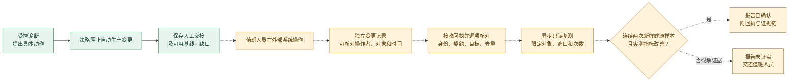

# 人工执行回执：怎样把交接接成可验证的闭环

生产变更由值班人员在自己的授权流程中完成。系统先给出对象、证据缺口、影响范围、停止条件和回退方案，并尝试保存新鲜的操作前服务状态；采集失败会列为缺口。这只是**可审查的交接**。本项目目前没有接收并核验人工执行回执的接口，因此交接后的生产恢复仍不能自动报告为“已确认”。下面是后续接入必须满足的验收契约，不是已经上线的功能。

**实线**是系统内的提案与交接边界；**虚线**是尚未打通的人工操作、回执及生产效果链路。图中的“已确认”只有在整条证据链满足下列条件时才能出现。

| 关口 | 必须核对什么 | 不满足时怎样报告 |
| --- | --- | --- |
| 操作者 | 服务端从已验证的人类身份取得操作者；拒绝匿名身份、共享 API 密钥及请求正文自填姓名 | 不接收为可信执行回执 |
| 动作 | 回执的唯一编号、原提案摘要、目标对象及版本、实际参数、开始和完成时间、结果、外部变更记录逐项对应 | 保留原提案，标为回执冲突或未证实 |
| 持久化 | 原子且只追加；重复提交同一回执幂等，内容变化或并发冲突拒绝；重启后仍可核对原记录 | 不启动效果验证 |
| 效果 | 只读复测与操作前基线对齐；同一范围内有两次采样时间递增、晚于操作完成的健康样本，并有实测服务指标改善、无阻断性退化 | 显示“未证实／部分支持”，保留缺口和反证 |

建议的回执接口是 `POST /api/v1/agent/workflow/runs/{runID}/steps/{stepID}/execution-receipts`。它只能接收经过身份认证的操作声明，并返回 `202` 表示已排队核对；不能在请求中运行生产命令，也不能把提交成功写成执行成功。HTTP 请求的时间上限短于操作后观察窗口，复测应由独立任务进行。现有 `ResumeRun` 只改变运行状态，不能替代回执接收或效果验证。

一个已认证的提交者，只能证明**谁提交了声明**。要证明**谁在生产环境做了什么**，还须向独立变更系统核验其记录；要证明**服务恢复**，还须取得动作后的新鲜遥测。即便两者都有，也应把“与处置后恢复一致”的观察结论同严格因果证明区分开。

接入时至少要测试：无身份或错误角色、共享密钥身份、目标／版本／提案不符、重复和并发提交、未来或早于基线的时间、失败或不确定的执行结果、重启后回执不丢失、旧遥测不能通过、两次新样本可以通过，以及验证任务只调用只读工具。缺少操作前基线或外部记录核验时，应停在“人工声明已收到／结果未证实”。
